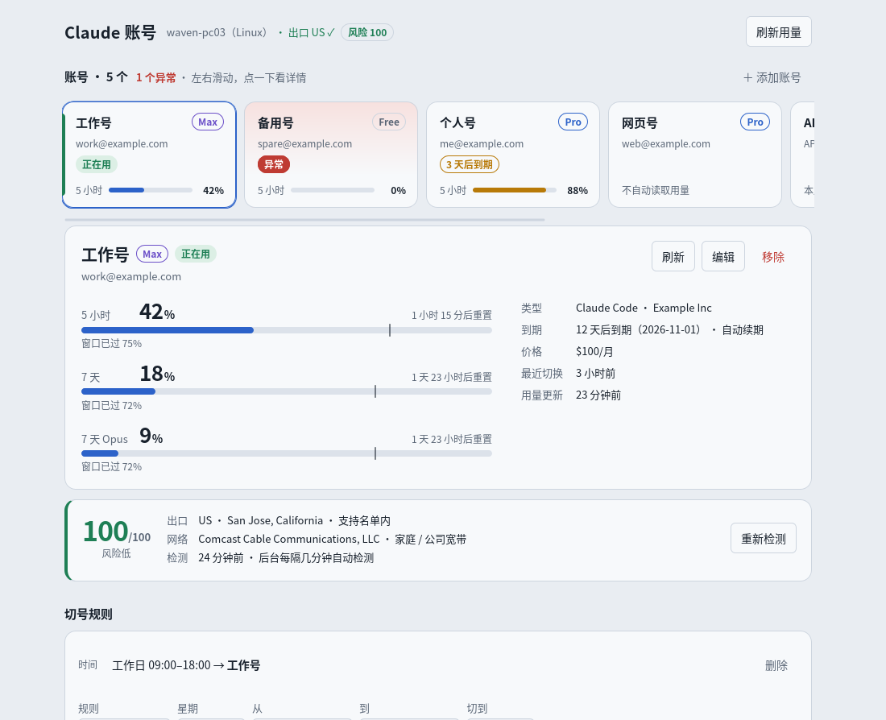
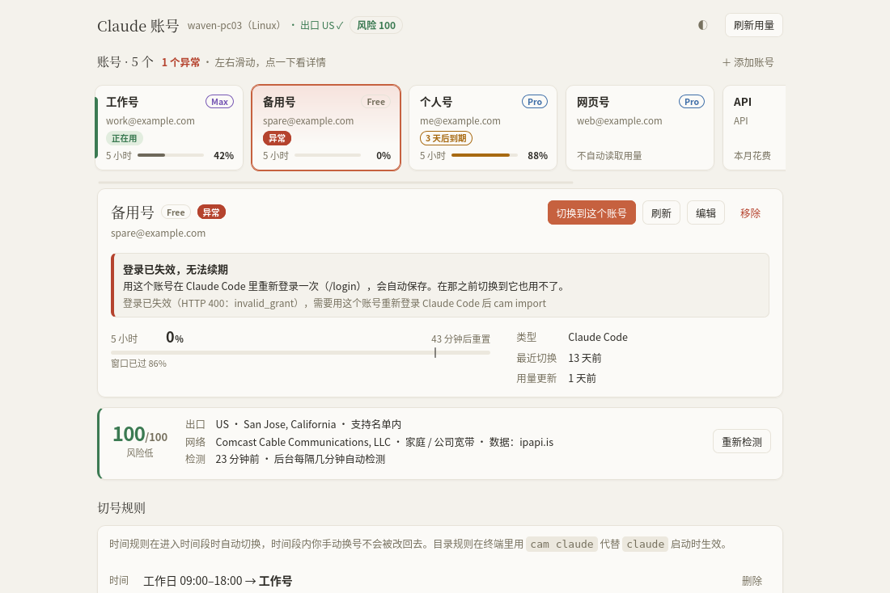
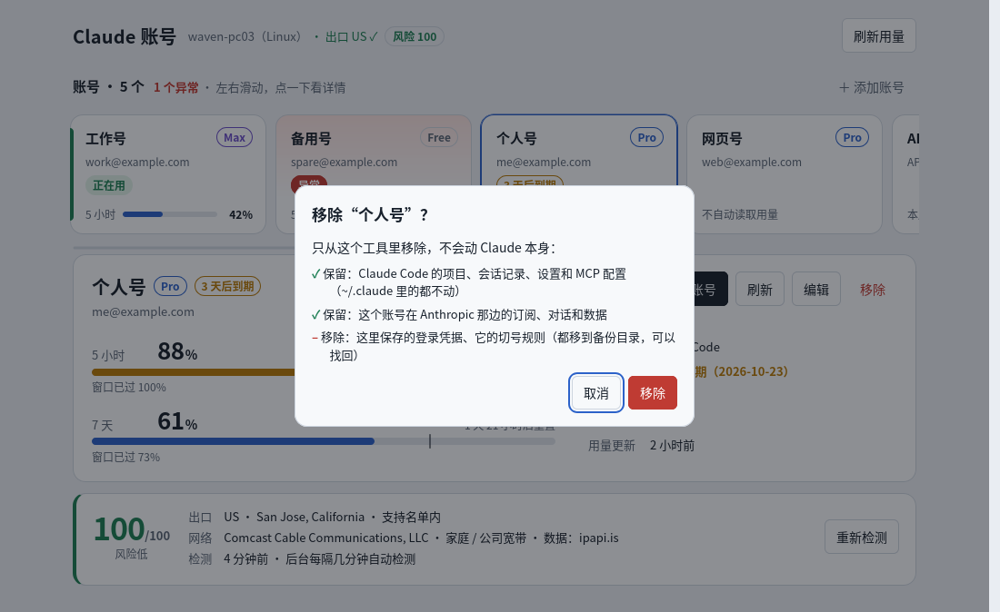
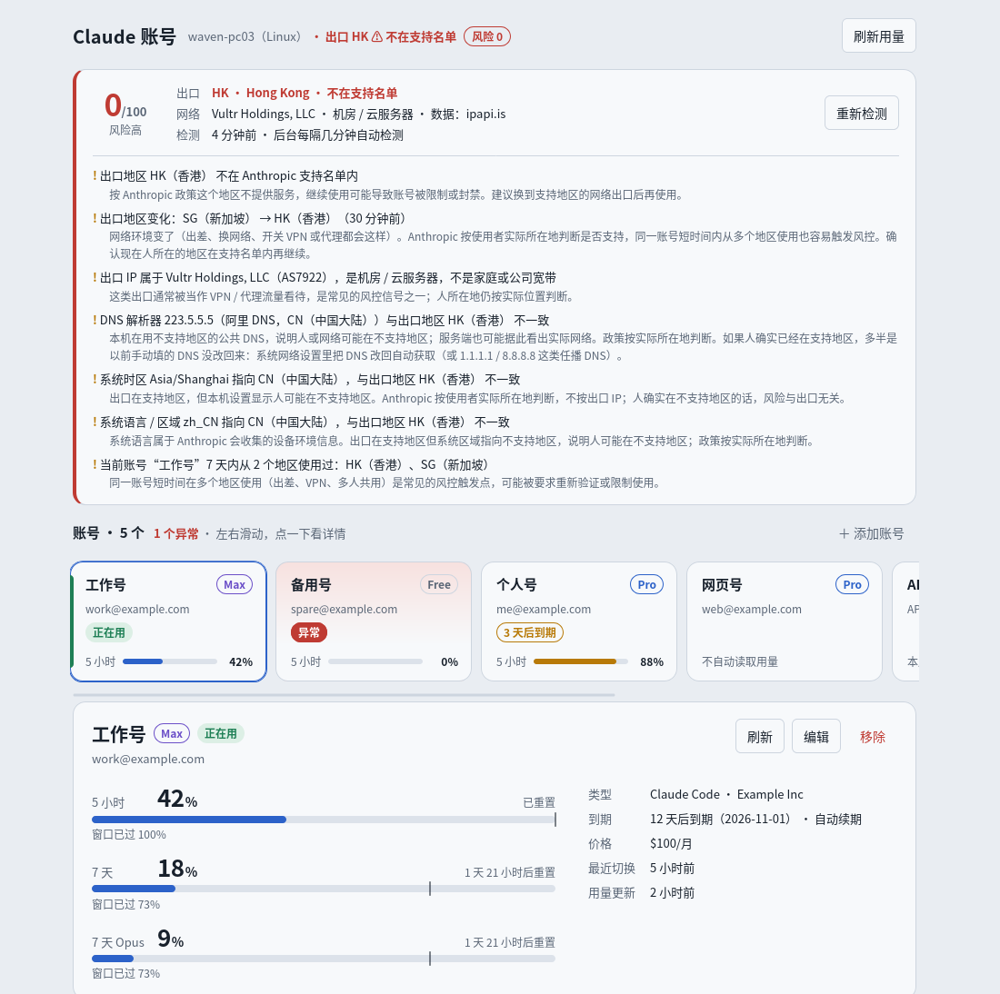
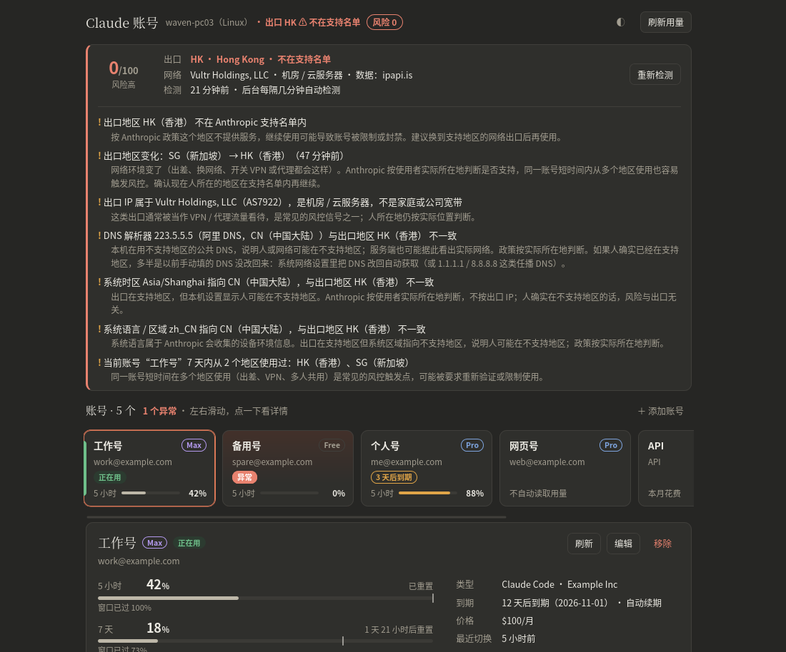
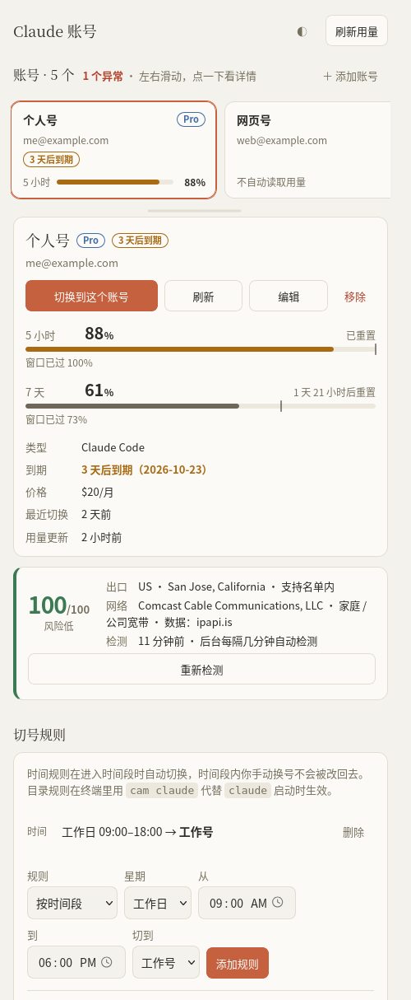

# Claude 账号管理

管理多个 Claude 账号：一键切换，查看每个号的 5 小时和 7 天额度、重置时间、到期日。支持桌面（macOS / Windows / Linux）、手机浏览器和命令行，三端共用同一份数据。

支持两类账号：
- **Claude Code（命令行）**：走 `api.anthropic.com`，能一键切换登录、自动读取额度。
- **网页版 claude.ai**：走 `claude.ai`，每个号一个独立浏览器窗口长期保持登录；填入一次 sessionKey 后也能自动显示额度。适合只能访问网页、无法使用命令行接口的环境（例如公司网络屏蔽了 `api.anthropic.com`）。

| | 脚本版 `cam` | 桌面版 | 手机 / 其它电脑 |
|---|---|---|---|
| 需要什么 | Python 3.8+，无第三方依赖 | 安装包 | 浏览器 |
| 切换 Claude Code 账号 | ✓ | ✓（托盘菜单一键切换） | ✓（切的是电脑上的账号） |
| 查看用量 / 到期 | ✓ | ✓（macOS 菜单栏直接显示 %） | ✓ |
| 自动发现新登录的账号 | `cam` / `cam serve` 运行时 | 后台常驻 | — |
| 时间规则自动切号 | `cam serve` 运行时 | 后台常驻 | 可设置 |
| 目录规则自动切号 | `cam claude` | 可设置（通过 `cam claude` 生效） | 可设置 |
| 额度提醒 | 终端输出 | 系统通知 | — |

## 界面一览

桌面版和手机面板是同一套界面，按"选账号 → 看详情 → 操作"组织。配色是暖色米白和赭橙强调，有明亮和暗黑两套，顶栏右边的 ◐ 按钮在"跟随系统 → 明亮 → 暗黑"之间切换（只记在这台设备上）：



- **账号条**：每个账号一张卡，横向滑动（手机上用手指滑）。卡上有名称、套餐标签（Free / Pro / Max / Team / Enterprise 不同颜色，拿不到时显示"套餐未知"，可在"编辑"里手动选）、状态（正在用 / 异常 / 注意 / 快到期）和 5 小时用量。Claude Code 当前账号排最前，最后一张是"+ 添加账号"。点哪张，下面就显示哪个。
- **详情**：大号额度条（数字是已用百分比，竖线是窗口已过去的时间，用得比时间快会提示）、到期 / 价格 / 最近切换 / 备注，右上角是操作：切换到这个账号（网页号是"在电脑上打开"）、刷新、编辑、移除。
- **异常账号**：卡片标红"异常"，详情最上面写清楚出了什么问题、怎么修，并附原始报错。会判断的情况：没有保存凭据、登录已失效（refresh token 被吊销）、保存的登录属于别的账号、sessionKey 失效、API Key 无效、订阅已过期；网络或服务暂时出错标"注意"，不算异常。



- **移除**：只从这个工具里移除。Claude Code 的项目、会话记录、设置和 MCP 配置都保留，账号在 Anthropic 那边的订阅和数据也不受影响；这里保存的凭据和它的切号规则移到备份目录，可以找回。Claude Code 正在用的账号要先切走才能移除。



- **环境状态卡**：风险评分、出口（国家 / 城市 / 是否在支持名单）、网络（运营商 / IP 类型）、上次检测时间，"重新检测"会实测一遍并按网络 / 本机 / 服务 / 账号分组展开。环境正常时放在账号详情下面；有风险时自动挪到最上面，逐条列出提醒和建议：



- **下方区块**：切号规则（时间段 / 项目目录、额度提醒阈值）、本机 Claude Code 近 14 天消耗、Claude 服务检测。桌面版另有"手机与设置"页：开关手机访问并显示二维码、打开数据目录；关窗口缩到托盘，托盘菜单一键切换。

暗黑模式：



手机上是同一个页面，账号卡用手指左右滑，详情和按钮竖排、加大便于点按；"添加到主屏幕"后用起来和 App 一样：



命令行和 macOS 菜单栏显示同样的信息：`cam` 列表里异常账号下面有"✗ 异常：原因。怎么修"，末尾是环境风险评分；菜单栏在账号名后标"⚠ 异常"，子菜单列出原因和建议。截图用的是示例数据。

## 菜单栏小工具（macOS，推荐）

菜单栏常驻显示当前账号和 5 小时额度，例如“工作号 64%”，超过 70% 变黄，超过 90% 变红。点开能看到每个号的 5 小时 / 7 天额度、重置时间和到期日，点一下就能切换。

```bash
bash extras/swiftbar/install.sh
```

脚本会自动安装 [SwiftBar](https://github.com/swiftbar/SwiftBar)（需要 Homebrew；没有的话会告诉你去哪下载），并把插件装好。插件每分钟运行一次，同时负责：
- 自动保存新登录的账号
- 执行时间规则
- 每 10 分钟刷新用量
- 额度超过阈值时弹系统通知

所以装了它，不开桌面版也是全自动的。桌面版或 `cam serve` 同时在运行时，后台任务交给它们做，插件只负责显示菜单（菜单底部会写“自动刷新由桌面版或 cam serve 负责”），不会几个程序同时轮询。

## 第一次使用（每个账号做一次）

工具不保存密码。Claude 登录要走邮箱验证或 Google 授权，所以每个号的第一次登录需要你自己完成：

1. 终端运行 `claude`，输入 `/login`，在浏览器里登录第一个账号
2. 运行 `cam`（或在桌面版 / 手机面板的账号区点"检测新登录"），它会发现这个账号并保存；桌面版和 `cam serve` 在后台也会自动发现
3. 再次 `/login` 登录第二个账号（Claude Code 会直接替换当前登录，已保存的号不会丢），重复第 2 步，依此类推

完成后：
- **切换**：`cam switch 工作号`，或在桌面版 / 托盘 / 手机上点一下
- **用量**：后台每 10 分钟自动刷新
- **登录过期**：后台定时刷新不会替不常用的号续登录（避免和 Claude Code 抢 refresh token），过期后会提示“登录已过期”。手动刷新一次（`cam usage`，或在桌面版 / 菜单栏 / 手机上点“刷新”）就会自动续上；切换到这个号也行
- **到期日**：官方没有接口，在"编辑"里填一次并勾选"自动续期"，之后每个周期会自动顺延

## 切换时不会丢的东西

切换只替换登录凭据（`~/.claude/.credentials.json`，macOS 是钥匙串里的 `Claude Code-credentials`）和 `~/.claude.json` 里的 `oauthAccount` 字段。以下内容都不动：

- 会话记录（`~/.claude/projects/`），切换后 `claude --continue` 照常接着聊
- `settings.json`、`CLAUDE.md`、MCP 服务器、插件、项目权限
- `~/.claude.json` 里的其它所有字段

每次切换前会先做两件事：
- 把当前账号最新的 token 回写保存。Claude Code 运行时会刷新 token，不回写的话下次切回来就失效了。
- 把切换前的现场备份到 `~/.claude-accounts/backups/`，保留最近 30 份。

正在运行的 `claude` 进程内存里还是旧账号，切换后需要退出重开。不重开的话，它刷新 token 后还可能把旧账号写回凭据文件。所以切换时工具会检查有没有 `claude` 在运行：
- `cam switch` 在终端里会先列出这些进程并问一句是否继续（加 `-y` 不问）
- 桌面版、手机面板、时间规则、`cam claude` 切换后会提示还有几个 `claude` 在运行

万一旧会话真的把旧账号写回了，工具以凭据为准，把 token 存回它真正的主人名下，不会覆盖别的号，并在 `cam` / `cam doctor` / 菜单栏里提示“Claude Code 实际在用的登录属于某某”。退出所有 `claude` 会话后重新切换一次即可。

## 脚本版

```bash
# macOS / Linux：把 scripts 加入 PATH（或者直接 python3 scripts/cam.py）
export PATH="$PATH:/path/to/claude-account-manager/scripts"

cam                       # 列出所有账号；顺便自动保存新登录的账号
cam usage                 # 刷新用量
cam switch 工作号          # 按名称 / 序号 / 邮箱 / id 切换
cam switch 工作号 --wait   # 有 claude 会话在跑时，等它们都退出后再切（不打断正在跑的任务）
cam set 工作号 --expires 2026-11-03 --auto-renew --price '$100/月'
cam serve --lan           # 启动 Web 面板，手机扫链接即可访问
cam local --days 7        # 本机每天消耗了多少 token、记在哪个号上
cam doctor                # 逐项检查环境，并实测 Claude 服务是否正常（出口地区、api.anthropic.com、claude.ai）；不显示密钥
cam env install           # 用 Anthropic 官方安装器安装 Claude Code
cam env clean             # 清理 Claude Code 缓存（默认只预演，加 --apply 才执行）
```

Windows 用 `scripts\cam.cmd`，用法相同。

### Claude Code 环境：检查、安装、清理

`cam doctor`（也可以写成 `cam env doctor` / `cam env check`）除了检查登录和数据目录，还会查出几类常见的“切换了却不生效”。

python.org 装的 Python（macOS 上常见）默认不带根证书，https 请求会报 `CERTIFICATE_VERIFY_FAILED`。脚本版发现默认证书一张都没加载到时，会自动改用 `SSL_CERT_FILE`、certifi（装了的话）或系统自带的证书文件（macOS 是 `/etc/ssl/cert.pem`），证书照常校验，`cam doctor` 会写明用的是哪个文件。

常见的“切换了却不生效”：
- PATH 里有好几份 `claude`（比如 npm 版和原生版并存），会列出来并标明实际运行的是哪个
- 设置了 `ANTHROPIC_API_KEY`、`ANTHROPIC_AUTH_TOKEN`、`CLAUDE_CODE_OAUTH_TOKEN` 等环境变量，或者 `settings.json` 里配了 `apiKeyHelper`、`~/.claude.json` 里存着 `primaryApiKey`。这些都优先于订阅登录，切换账号就没有效果
- 当前有几个 `claude` 进程在运行

最后一段"服务检查"实测 Claude 服务本身是否正常，并把使用环境里的风险点逐项列出来，排查"是网络问题、环境问题还是账号问题"。第一行是总体结论：环境风险评分（满分 100，每个风险点按轻重扣分）加档位——90 分以上"风险低，可以使用"，70–89"有风险，建议先处理提醒项再使用"，70 以下"风险高，不建议在当前环境使用；是否继续由你决定"——再带上最严重的那一条。评分只汇总本机能看到的信号，满分也不代表一定合规。下面每一项都附"→ 这意味着什么、建议怎么做"。**全部只提醒，不拦任何操作**，是否继续由用户自己决定：
- DNS：`api.anthropic.com`、`claude.ai` 解析到哪里
- 出口地区：从 Cloudflare 看到的国家、城市、IP 和节点，并对照 Anthropic 官网公布的支持国家/地区名单（美国、英国、日本等 180 多个；中国大陆、香港、澳门、俄罗斯等不在内）。不在名单内会醒目提醒：按 Anthropic 政策该地区不提供服务，继续使用可能导致账号被限制或封禁，建议换到支持地区的网络出口。在名单内也会说明：这只是 IP 这一项没问题，Anthropic 结合 IP 和其他信号综合判断所在地。名单会变，以官网为准
- 网络服务商和 IP 类型：出口 IP 属于哪个运营商（ASN），数据库判定它是家庭 / 公司宽带、机房 / 云服务器、代理 / VPN 出口、Tor 出口节点还是手机网络。机房、代理、Tor 都会提醒：这类出口通常被当作 VPN / 代理流量看待。数据源见下面"隐私与数据源"，默认都可以商用；没有类型标记时按运营商名里的关键字判断
- IP 归属：IP 在 RIR 登记的国家（RDAP）和定位国是否一致（原生 IP / 广播 IP）。不一致时说明不同地理库可能判到不同国家
- IPv4 / IPv6 双栈：两个协议分别测出口。VPN / 代理通常只接管 IPv4，IPv6 直接从本机网络出去，两边地区不同时提醒"服务端通过 IPv6 看到的就是本机网络的真实出口"
- 出口地区判定一致性：两个接口看到的国家不一致（代理只分流了一部分）时提醒
- DNS 解析器：本机配置的 DNS 服务器是局域网的、任播公共 DNS（Google、Cloudflare 等，不拿来判断位置）还是某个国家的公共 DNS（阿里、腾讯、114、HiNet 等）；用的是不支持地区的公共 DNS 而出口在支持地区时提醒。**只读本机配置，不做泄漏探测**（泄漏探测要往第三方的记录服务发带标识的查询，没有做）
- `api.anthropic.com`：用当前登录实测，区分"服务正常 / 登录已过期 / 拒绝访问（通常是地区不支持）/ 连不上 / 服务端故障"，并显示时延
- `claude.ai`：是否可达，是否被公司网络的人机验证页拦住（只影响网页账号读额度，不影响切号）
- 代理：当前终端的代理环境变量，以及系统级代理设置（macOS 网络设置、Windows Internet 选项、GNOME）；有代理时出口地区就是代理的出口
- VPN：本机默认路由是否走隧道接口（utun / tun / wg / TAP 等）；走隧道时出口地区是 VPN 的出口，不代表人在哪里。只看默认路由，透明代理和路由器上的 VPN 看不出来
- 出口地区变化：和上一次检测相比出口换了国家（出差、换网络、开关 VPN），24 小时内持续提醒。Anthropic 按使用者实际所在地判断，同一账号短时间内多地区使用也容易触发风控
- Cloudflare WARP / Zero Trust：请求经过 WARP 时说明出口不是本机真实出口
- 本机时钟：和服务器相差超过 2 分钟会提醒（影响登录续期、HTTPS 校验，也是风控信号）
- Anthropic 官方状态页：`status.anthropic.com` 当前有无故障，有故障时说明是 Anthropic 侧的问题
- 系统时区：时区指向的国家和出口地区不一致时提醒；指向不支持地区时特别说明"政策按人所在地判断，不按出口 IP"
- 系统语言 / 区域：和出口不一致时只作参考、扣 5 分（语言只代表语言习惯，新加坡、美国很多人也用 zh_CN），建议在"语言与地区"里把地区改成所在国家（macOS 的 AppleLocale、Windows 的 Get-Culture、Linux 的 LANG）
- 设备：系统和架构。设备环境信息 Anthropic 会收集，这里只列出来，**本工具不会改动或伪装任何设备标识**
- 账号使用地区：当前账号 7 天内从几个地区使用过（每次后台检测和切换都会记一笔），多地区使用是常见的风控触发点
- 账号数：本机保存了几个 Claude Code 账号，并提示账号不能给别人用（消费者条款第 2 条）
- 检测范围：最后一条说明本工具只能看到本机和网络层面的信号，账号侧的信号看不到，所以"没有发现风险点"不等于一定合规

桌面版的"手机与设置"页和手机面板底部也有"Claude 服务检测"按钮，结果一样。另外桌面版、`cam serve`、菜单栏插件会随用量刷新每隔几分钟记一次出口地区、WARP、时钟偏差和官方状态页，面板和桌面版顶部常显"出口 US ✓"和据缓存算的"风险 92"徽章（实测的分数以 `cam doctor` 为准）；上面这些风险点里级别为"提醒"或"故障"的（出口不在名单、出口变化、时区指向不支持地区、时钟偏差、官方故障、账号多地区）会常显在页面顶部、菜单栏和 `cam` 列表里，`cam switch` 和面板切换前也会再提醒一次，但照样切。

```bash
cam env install            # 没装就用官方原生安装器装（curl -fsSL https://claude.ai/install.sh | bash，Windows 用 install.ps1）
cam env install --npm      # 改用 npm install -g @anthropic-ai/claude-code
cam env install --force    # 已经装了也重装，可用来升级
```

运行前会显示完整的安装命令并确认，非交互环境要加 `-y`。

```bash
cam env clean                      # 预演：列出将删除的缓存和大小，不改任何东西
cam env clean --apply              # 删除可以重新生成的缓存（cache、statsig、shell-snapshots、debug 等）
cam env clean --logout --apply     # 同时退出 Claude Code 登录
cam env clean --purge --apply      # 把整个 Claude Code 配置移到备份目录，相当于全新安装
```

- 默认只删一份固定名单里的缓存。会话记录（`projects/`）、`settings.json`、`CLAUDE.md`、commands / agents / skills / plugins、`~/.claude.json` 里的项目配置、cam 自己的数据目录都不动
- `--logout` 退出前先把当前账号的最新凭据存进 cam，之后 `cam switch` 能切回来；退出前的登录状态另外备份在 `backups/`
- `--purge` 不删除，而是把 `~/.claude/`、`~/.claude.json`（macOS 还有钥匙串里的登录）移到 `~/.claude-accounts/env-backups/<时间>/`，要恢复时移回去即可。这一步会带走会话记录和设置，所以会再确认一次（`-y` 跳过）
- 有 `claude` 正在运行时拒绝执行，先退出它们，或加 `--force`

### 切号规则

```bash
# 时间规则：工作日 9 点到 18 点用工作号，进入时间段时自动切换
cam rule add-time 工作号 --days 1-5 --start 09:00 --end 18:00
cam rule add-time 个人号 --days 1-5 --start 18:00 --end 09:00   # 可以跨午夜

# 目录规则：在 ~/work 下用 cam claude 启动时自动用工作号（参数原样透传给 claude）
cam rule add-dir ~/work 工作号
cd ~/work/some-project && cam claude --continue

# 额度提醒阈值（当前号 5 小时额度超过 85% 时提醒，并告诉你多久后重置）
cam rule alert 85
cam rule ls
```

时间规则只在"进入时间段"的那一刻切换，时间段内你手动换号，工具不会再改回去。进入时间段时如果有 `claude` 会话正在运行，不会打断它：先记下来，等会话都退出后再切；要是整个时间段都没等到，就作废。

### 切换时有会话在跑

切换只替换凭据，正在运行的 `claude` 会话内存里还是旧账号的 token，需要退出重开。所以有会话在跑时：
- `cam switch` 在终端里会问你：等它们结束后再切（默认）、现在就切、还是取消。`--wait` 直接选"等"，`-y` 直接选"现在切"
- 桌面版和手机面板会弹同样的三选一；选"等"之后页面顶部会显示"等当前 claude 会话结束后自动切换到 X"，随时可以取消（`cam switch --cancel-wait` 也行）
- 菜单栏 / 托盘点一下切换，有会话在跑时默认就是"等"，并弹通知告诉你
- 等待期间由桌面版、`cam serve` 或菜单栏插件在后台盯着，会话一退出就切；`cam switch --wait` 自己也会一直等

想让目录规则对所有 `claude` 命令都生效，可以在 shell 配置里加一行 `alias claude='cam claude'`。

### 启动前的风险提醒（`cam claude`）

`cam claude` 启动前会看一眼环境风险评分，按档位提醒。一小时内没检测过时，只花最多 3 秒问一次 claude.ai 的出口，完整检测交给后台进程去做，不拖慢启动。**只提醒和确认，不拦截**，是否继续始终由你决定：
- 90 分以上：一行"环境风险 100/100，风险低"，直接启动
- 60–89 分：打印分数和每条提醒，直接启动（公司 VPN、出差换网一般落在这档）
- 30–59 分：打印后问"是否继续 [y/N]"，默认不继续，按 y 才启动
- 30 分以下，或出口不在 Anthropic 支持名单内（这条不看分数）：要输入"继续"两个字才启动，直接回车取消

```bash
cam risk                        # 查看当前档位、阈值和缓存的分数
cam risk --confirm 60 --strong 30   # 调整两个阈值
cam risk --off                  # 关掉启动前提醒（--on 打开）；CAM_NO_RISK_PROMPT=1 可临时关掉
```

非交互环境（脚本、CI、没有终端）只打印提醒，不会卡住等输入。桌面版和手机面板不负责启动 `claude`，它们在顶部常显同样的分数和提醒。

### 隐私与数据源

环境检测只发送这台电脑的**出口 IP**，不发送任何账号、邮箱或凭据。会访问哪些服务取决于"外部 IP 查询"设置：

| 设置 | 会访问 | 说明 |
|---|---|---|
| 关闭 `off` | `claude.ai/cdn-cgi/trace`、`status.anthropic.com` | 只看出口国家和官方状态，不查运营商、IP 类型、IPv6、注册国 |
| 自动 `auto`（默认） | 上面两个，加 `api.ipapi.is` → `ipinfo.io` → `speed.cloudflare.com`（按顺序，第一个查到的为准）、`rdap.org`、`1.1.1.1` 和 Cloudflare IPv6 | 都可以商用。ipapi.is 免费注册 key 每天 1000 次、带机房 / VPN / Tor 标记（官方写明可商用）；不配 key 每天 30 次、不带标记。ipinfo.io 免费版可商用但要求注明来源，界面上会写"数据：ipinfo.io" |
| 加上 ip-api `ip-api` | 自动的那些，并优先用 `ip-api.com` | ip-api.com 免费接口**仅限非商业用途**、只有 http，个人自用才选 |

出口 IP 没变时，运营商这些信息一天只查一次，第三方请求很少。

```bash
cam risk --ip-lookup off          # 关闭外部 IP 查询（auto / ip-api / off）
cam risk --ipapi-key 你的key       # 配 ipapi.is 的 key（空字符串删除），--ipinfo-token 同理
cam risk --clear-history          # 清除缓存的出口信息和每个账号的使用地区记录
cam risk                          # 查看当前设置和会访问哪些服务
```

桌面版"手机与设置"页和手机面板底部的"隐私与数据源"也能改。key 存在数据目录的 `secrets` 里，不进 `accounts.json`，不显示在任何界面。环境变量 `CAM_IP_LOOKUP`、`CAM_IPAPI_IS_KEY`、`CAM_IPINFO_TOKEN` 优先于保存的设置。

**给客户用时**：建议每台电脑各注册一个免费的 ipapi.is key（一个 key 每天 1000 次，多台共用会不够），或者你买付费版统一配置；不想把出口 IP 发给第三方的客户，设成 `off` 就行，出口地区和官方名单检测照常。

额度满了自动换下一个号的功能**没有做**。官方条款没有明确禁止一个人拥有多个账号，但明确禁止：把账号给别人用或分享登录信息（消费者条款第 2 条）、转售或代理给别人用、被封后换号继续用、为躲避检测开多个号（使用政策 Do Not Abuse Our Platform）。“一个号额度用完马上换下一个”条款没有直接点名，但可能被认定为绕过系统或防护措施（消费者条款第 3 条），由 Anthropic 判定。所以工具只负责提醒，换不换由你一键决定。需要更多额度，官方方式是升级 Max、开额外用量，或用 API 按量计费。

### 网页版和 API 账号

```bash
cam add-web --label 家里网页号     # 每个网页号一个独立的浏览器 Profile
cam open 家里网页号                # 打开它专属的窗口，第一次在里面登录，以后一直保持登录
cam add-api --label 项目A --key sk-ant-api03-... --admin-key sk-ant-admin01-...
```

**让网页账号自动显示额度（填一次 sessionKey）**

1. 在浏览器登录 claude.ai
2. 按 F12 打开开发者工具 → Application / 应用 → Cookies → `https://claude.ai`
3. 找到名为 `sessionKey` 的条目，复制它的值（以 `sk-ant-` 开头）
4. 填进工具：`cam set 家里网页号 --session-key <粘贴的值>`

之后 `cam usage` 会自动显示这个号的 5 小时 / 7 天额度，并读出邮箱和套餐。sessionKey 会过期（通常几周到一两个月），过期后工具会提示"sessionKey 已过期"，重复上面的步骤即可。

若 claude.ai 返回人机验证页，通常是网络被拦截（公司管控），和账号无关，工具会明确提示；这种情况下只能手动记录到期日。不填 sessionKey 也能用：每个号一键打开独立窗口，手动记录到期日并到期提醒。

API 账号填了 Admin Key 后会显示本月花费。

## 桌面版

位于 `desktop/`，基于 Tauri 2 + React。

```bash
cd desktop
npm install
npm run tauri dev      # 开发
npm run tauri build    # 打包，产物在 src-tauri/target/release/bundle/
```

需要先安装 Rust 和 Node 20+。Linux 还要装 `libwebkit2gtk-4.1-dev libappindicator3-dev librsvg2-dev`。

**一键编译安装**：`bash scripts/build-desktop-mac.sh`（Windows：`powershell -ExecutionPolicy Bypass -File scripts\build-desktop-windows.ps1`）。脚本会自动安装缺少的 Rust，编译后把 App 装进“应用程序”。如果失败，把生成的 `build.log` 发给作者。

**不想本地编译**：把项目推到 GitHub，`.github/workflows/build.yml` 会自动编译 macOS（通用版）、Windows、Linux 三个平台的安装包，在 Actions 页面下载。推送 `v1.0.0` 这样的标签会生成 Release 草稿。

桌面版功能：
- 关闭窗口后缩到托盘继续运行。托盘菜单列出所有账号和额度，点一下即可切换。macOS 菜单栏直接显示当前账号的 5 小时用量百分比。
- 后台自动发现新登录的账号、执行时间规则、刷新用量，额度超过阈值时弹系统通知。同一台电脑上桌面版、`cam serve`、菜单栏插件只有一个在做这些事，谁先启动谁做，其它的只同步显示。
- 在"手机与设置"里开启 Web 面板后，手机扫二维码就能查看和切换。

macOS 首次打开未签名应用时，需要右键选择"打开"。

## 手机访问

在桌面版"手机与设置"里开启，或者在电脑上运行 `cam serve --lan`。手机和电脑连同一个 Wi-Fi，扫码或打开打印出来的链接即可。在浏览器菜单里"添加到主屏幕"后，用起来和 App 一样。

链接里带访问令牌，相当于密码。不在同一个网络时，建议在电脑和手机上都装 [Tailscale](https://tailscale.com) 这类组网工具，不要把端口直接暴露到公网。

## 数据与安全

- 所有数据存在 `~/.claude-accounts/`（可用 `CAM_HOME` 改位置），目录权限 700、凭据文件权限 600，不上传任何地方
- 网络请求只发往 `api.anthropic.com`（用量、资料）、`platform.claude.com` / `console.anthropic.com`（续登录），以及你主动填了 sessionKey 时的 `claude.ai`。服务检查和后台的出口地区记录另外会访问哪些服务，见上面"隐私与数据源"，可以关闭；这些请求只带出口 IP，不带任何账号信息。账号的使用地区记录只存在本机 `accounts.json` 里，`cam risk --clear-history` 可清除。`cam env install` 会运行 Anthropic 官方安装器（从 `claude.ai` 下载），或者用 npm 安装
- 用量和资料接口是 Claude Code 自己在用的接口，并非公开 API，Anthropic 改动后可能需要更新本工具；拿不到数据时界面会显示原因，不影响切换
- 删除账号时凭据会移到 backups 目录，不直接销毁
- 只有确认了"当前这份登录是谁的"才会存进对应账号：refresh token 和某个账号保存的一致，或者联网核对过。离线、或者 access token 已过期又换过 refresh token 时核对不了，就先暂存（`secrets/_pending-live.json`），不往任何账号里写，界面上会提示；联网后或切换时核对清楚再归档。这样旧会话写回的别人的 token 不会被存错账号

## 目录结构

```
scripts/cam.py        脚本版（单文件，可单独拷走使用）
scripts/test_cam.py   脚本版端到端测试（伪造 HOME 和接口，不碰真实账号）
scripts/build-desktop-*  桌面版一键编译脚本
extras/swiftbar/      macOS 菜单栏小工具
web/panel.html        Web 面板（手机 / 浏览器），脚本版和桌面版共用
desktop/              Tauri 桌面版
desktop/src-tauri/engine/  核心逻辑 crate cam-engine，与 cam.py 对应的 Rust 实现，不依赖 Tauri
tests/shared/         两边共用的测试数据（身份识别、账号查找、切号规则、自动续期、编辑账号和到期日）
docs/DESIGN.md        数据格式、切换流程、锁、HTTP API
```

## 测试

```bash
python3 scripts/test_cam.py                         # 脚本版
cd desktop/src-tauri && cargo test -p cam-engine    # Rust 核心逻辑，不需要 Tauri 的系统依赖
```

两边都会跑 `tests/shared/` 里的同一份数据，改规则时两边要一起改，否则测试会失败。
